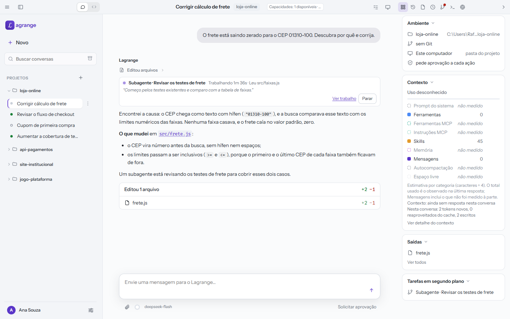
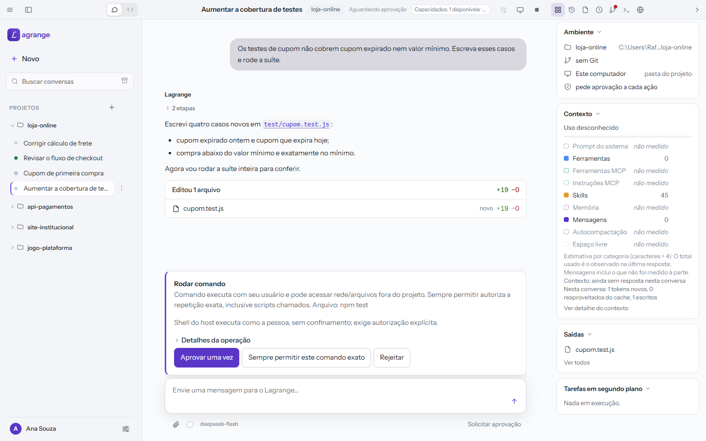
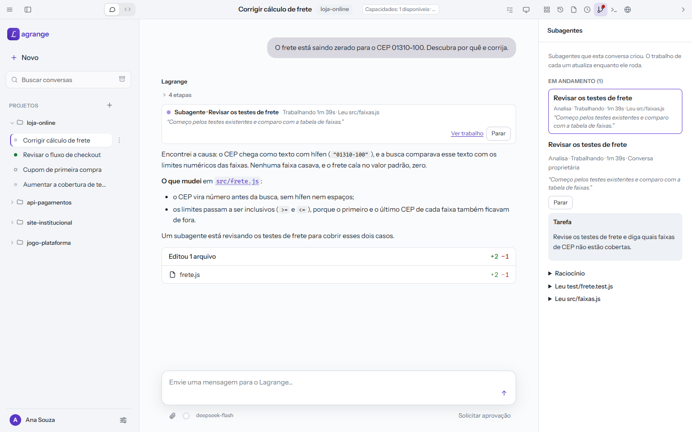
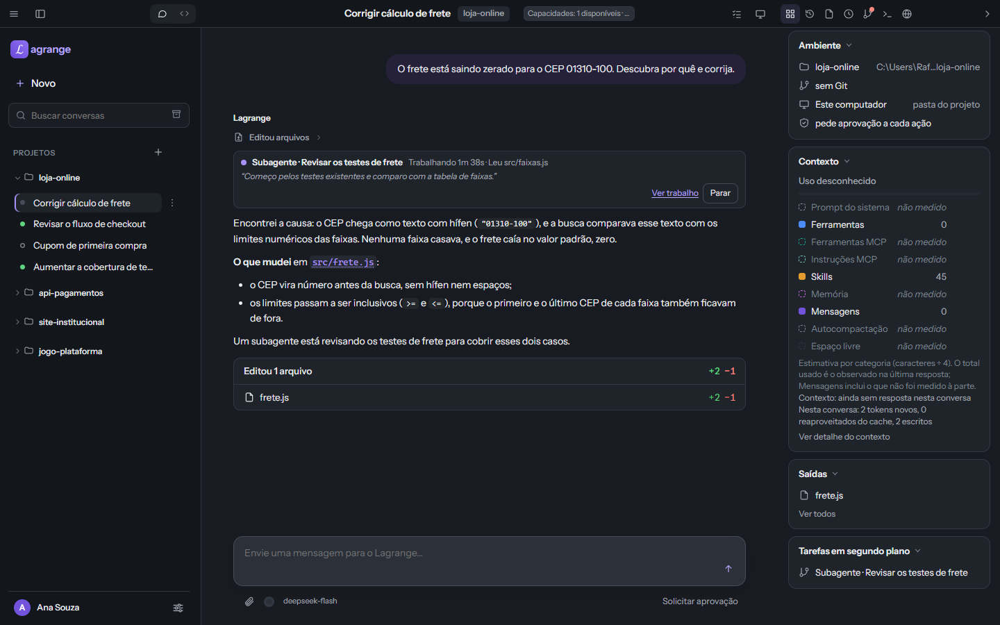

# ℒ Lagrange

O Lagrange é um assistente de IA para Windows que trabalha nos seus projetos usando modelos abertos e baratos, como DeepSeek, Kimi, GLM e Qwen, pela API do provedor que você escolher. Ele lê e altera arquivos, roda comandos, divide tarefas entre subagentes e opera o navegador, o Blender e o Unity. O que ele pode fazer sozinho e o que precisa da sua aprovação é decidido por você.

Você usa pela janela do app, pelo terminal ou dentro do VS Code, e as três formas compartilham o mesmo projeto, as mesmas conversas e a mesma memória. O assistente roda na sua máquina; só o modelo fica na nuvem do provedor.

Este repositório guarda só o instalador e as versões publicadas. O código-fonte é privado.



| No modo padrão, editar arquivos e rodar comandos fora do sandbox pede aprovação | Subagentes trabalham em paralelo, e você acompanha cada um |
|---|---|
|  |  |

<details><summary>Tema escuro</summary>



</details>

As imagens são de um projeto de demonstração e são geradas a cada versão, a partir da própria interface publicada.

## O que ele faz hoje

- **Projetos.** Cada projeto (uma pasta, com ou sem Git, ou um projeto guardado pelo app) tem as suas conversas, memória, regras e consumo. Há também conversas pessoais, fora de qualquer projeto.
- **Subagentes.** Uma conversa pode entregar partes do trabalho a subagentes, que analisam ou editam em paralelo; cada subagente que edita usa a sua própria worktree. Você acompanha cada um e pode abrir a conversa de qualquer subagente.
- **Permissões.** Três modos:
  - **Solicitar aprovação** (padrão): ler o projeto e rodar comandos dentro do sandbox não pedem; editar arquivos e rodar comandos fora do sandbox viram um cartão para você aprovar.
  - **Aprovar por mim**: edita arquivos do projeto e usa os aplicativos preparados sem pedir.
  - **Acesso completo**: roda também comandos fora do sandbox, com o seu usuário do Windows, sem pedir.

  Pastas de segredos (`.env`, chaves, `.ssh`…) e a pasta do app ficam bloqueadas para as ferramentas de arquivo em todos os modos. Aprovações "sempre" podem ser revistas e revogadas. A política é aplicada pelo código, não pelo prompt.
- **Shell confinado.** Os comandos do agente rodam num sandbox do Windows (AppContainer), sem rede e sem acesso ao resto do seu perfil. Dentro do projeto, o sandbox lê tudo, inclusive arquivos como `.env`. A internet fica desligada até você ligar, por projeto.
- **Worktrees e desfazer.** Cada conversa pode trabalhar numa worktree separada: você revisa o diff e integra quando quiser. Também dá para desfazer a última resposta ou voltar a qualquer mensagem; isso restaura os arquivos que o agente mudou, então uma edição sua feita depois nesses mesmos arquivos também volta.
- **Aplicativos.** O navegador (contido), o Blender e o Unity, preparados pelo próprio app, com cada ação visual autorizada na sessão. Servidores MCP (GitHub, bancos de dados, ferramentas de design…) podem ser conectados por projeto.
- **Workflows** (experimental): tarefas de várias etapas executadas por subagentes, que você aprova antes de rodar.
- **Terminal, preview e pull requests** na própria janela.
- **Memória e skills.** O que ele aprende sobre o projeto vira memória que você confirma, exporta e importa; skills estendem o que ele sabe fazer.
- **Automações agendadas**, com limite de duração e, quando o preço do modelo é conhecido, orçamento definido na criação. Elas leem o projeto, mas não o alteram nem rodam comandos.
- **Custo.** Consumo de tokens e custo por conversa, por modelo e por projeto. O **Limite de custo** do projeto (em **Configurações**) barra a chamada antes de ela acontecer; vem vazio, ou seja, sem teto de gasto até você definir um.
- **Modo plano e imagens** por conversa, **esforço de raciocínio** por projeto, e avisos na área de trabalho quando algo pede a sua atenção com o app em segundo plano.

## Instalar

**[Baixe o LagrangeSetup.exe](https://github.com/rafa210587/lagrange/releases/latest/download/LagrangeSetup.exe)**, abra, escolha o que instalar e clique em **Instalar**.

Ou, no PowerShell (abre a mesma janela):

```powershell
irm https://raw.githubusercontent.com/rafa210587/lagrange/main/install.ps1 | iex
```

A instalação é **só para a sua conta** e **não pede administrador**. Leva poucos minutos e baixa cerca de 200 MB.

Enquanto o instalador não é assinado, o Windows pode mostrar "O Windows protegeu o computador": clique em **Mais informações → Executar assim mesmo**. O comando do PowerShell não passa por esse aviso.

### Escolher o que instalar

O instalador pergunta quais destas partes você quer; pode marcar uma, duas ou as três. O motor do assistente é instalado sempre, e as três usam o mesmo.

| Parte | Maturidade | O que é |
|---|---|---|
| **App do Lagrange** | Beta | A janela com as conversas por projeto, com atalho no Menu Iniciar. É a parte principal e a mais testada: aprovações, revisão de alterações, memória, worktrees, automações agendadas e os aplicativos (navegador, Blender, Unity) |
| **Terminal** | Beta | O comando `lagrange` em qualquer terminal: conversa em tela cheia, `exec` de um turno, sessões, modelo e memória do projeto. Muda com frequência |
| **Extensão do VS Code** | Prévia | O painel **Lagrange** (ℒ) na barra lateral do VS Code, conversando sobre a pasta aberta com a seleção e o arquivo como contexto. Só aparece como opção se o VS Code estiver instalado |

**Beta**: completo e testado, ainda mudando. **Prévia**: funciona, com menos testes. Tudo está na versão 0.1.

Para instalar sem perguntas (por exemplo, num script), diga as partes antes do comando: `$env:LAGRANGE_COMPONENTS = 'app,terminal'` (qualquer combinação de `app`, `terminal` e `vscode`).

Para mudar a escolha depois, rode o instalador de novo e marque o que quiser.

## Como usar

### 1. Pegue uma chave de API

O Lagrange conversa com o modelo que você escolher, pela API do provedor. O padrão é o **DeepSeek**, o único validado em uso real até agora. Os outros provedores abaixo aparecem no catálogo do app e devem funcionar igual, mas ainda não foram testados por nós.

| Provedor | Modelos (exemplos) | Onde criar a chave | Nome no app |
|---|---|---|---|
| **DeepSeek** (padrão, validado) | `deepseek-flash`, `deepseek-v4-pro` | [platform.deepseek.com](https://platform.deepseek.com/api_keys) | `deepseek` |
| Moonshot (Kimi) | `kimi-k3`, `kimi-k2.7-code` | [platform.moonshot.ai](https://platform.moonshot.ai) | `moonshotai` (ou `moonshotai-cn` para a conta da China) |
| Zhipu / Z.AI (GLM) | `glm-5`, `glm-5.3-flash` | [open.bigmodel.cn](https://open.bigmodel.cn) ou [z.ai](https://z.ai) | `zhipuai` ou `zai` |
| Alibaba (Qwen) | `qwen3.7-max`, `qwen-flash` | [Alibaba Cloud Model Studio](https://www.alibabacloud.com/product/modelstudio) | `alibaba` (ou `alibaba-cn`) |
| MiniMax | `MiniMax-M3` | [minimax.io](https://www.minimax.io) | `minimax` |
| SiliconFlow (vários modelos abertos) | Qwen, DeepSeek, Hunyuan e outros | [siliconflow.com](https://www.siliconflow.com) | `siliconflow` |

Qualquer outro provedor com API compatível com a da OpenAI também serve: no app, escolha **OpenAI compatível** e informe a URL e a chave.

**Seus dados:** o que você escreve e o que o assistente lê dos seus arquivos para responder vão para os servidores do provedor escolhido. Escolha o provedor de acordo com o que você pode compartilhar.

### 2. Configure no app

1. Abra o **Lagrange** pelo Menu Iniciar e clique em **Adicionar projeto** (uma pasta sua, ou um projeto novo guardado pelo app).
2. Vá em **Configurações → Modelos**.
3. Procure o provedor pelo nome (por exemplo, `deepseek`) e cole a chave. Ela vale para todos os seus projetos.
4. Marque os modelos que quer usar e clique em **Testar modelos habilitados**; cada um deve responder.
5. Salve. No chat, escolha o modelo embaixo da caixa de mensagem e converse.

A chave fica guardada com a proteção de dados do Windows (DPAPI), só para a sua conta; ela não vai para os arquivos do projeto.

### 3. No terminal

Com a chave configurada no app, na pasta de um projeto:

```powershell
lagrange                                  # conversa em tela cheia (-c continua a última)
lagrange exec "resuma o README"           # uma pergunta e a resposta, sem tela cheia
lagrange model deepseek/deepseek-flash    # o modelo deste projeto (provedor/modelo)
lagrange doctor                           # confere instalação, projeto e modelo
```

Digite `/` dentro da conversa para ver os comandos (`/modelo`, `/plano`, `/revisar`, `/desfazer`…). `lagrange --help` lista o resto.

### 4. No VS Code

Abra uma pasta confiável e clique no ícone **ℒ** na barra lateral (ou **Ctrl+Alt+L**). O painel conversa sobre essa pasta; use o chip do arquivo aberto e da seleção para dar contexto. A extensão usa o modelo e a chave configurados no app.

## Requisitos no Windows

- Windows 11, 64 bits (x64). O Windows 10 deve funcionar, mas ainda não foi validado.
- **Disco:** cerca de 700 MB (uns 450 MB se você já tiver o PowerShell 7); cada atualização guarda mais uns 60 MB, porque a versão anterior fica ao lado.
- **Memória:** cada projeto aberto usa cerca de 1 GB. No máximo três ficam ligados ao mesmo tempo: ao abrir um quarto, o que você usou há mais tempo é suspenso (a não ser que esteja trabalhando) e volta sozinho quando você retorna a ele; um projeto parado por 30 minutos também é suspenso. Recomendado: 16 GB de RAM.
- **Idioma:** a interface é em português.
- Internet durante a instalação e para conversar com o modelo. Redes com proxy ainda não foram testadas.
- Uma chave de API de um provedor de modelo (veja [Como usar](#como-usar)).
- Opcionais: **Git**, para projetos com worktree por conversa; **VS Code**, para a extensão; **Blender** e **Unity**, para operar esses aplicativos.

## O que o instalador Windows faz

1. Baixa, para `%LOCALAPPDATA%\HarnessAI\runtime`, versões fixas de **Node.js**, **uv** e, se não houver um no sistema, **PowerShell 7**. Cada arquivo é conferido pelo SHA-256 antes de ser usado. Nada é instalado no sistema como um todo.
2. Instala o **Python 3.12** pelo uv, também só para a sua conta (na pasta do uv, `%APPDATA%\uv\python`).
3. Baixa a última versão do Lagrange desta página de Releases e confere o SHA-256 publicado ao lado dela (isso detecta um download corrompido, não substitui uma assinatura).
4. Instala o **Microsoft Edge WebView2 Runtime** se ele faltar (já vem no Windows 11).
5. Conforme a sua escolha: cria o atalho no Menu Iniciar, põe o comando `lagrange` no PATH da sua conta (com o **Terminal**) e instala a extensão no VS Code. O pacote da extensão fica também em `%LOCALAPPDATA%\HarnessAI\bin\lagrange.vsix`.

A instalação só baixa arquivos; nenhum dado seu é enviado. Se algo falhar, o registro completo fica em `%TEMP%\lagrange-setup.log`.

## Atualizar no Windows

Antes, encerre cada projeto aberto em **… → Encerrar workspace**. Fechar a janela não basta: o projeto continua ligado em segundo plano por até 30 minutos. Depois rode o instalador de novo. A versão nova fica ao lado da anterior; projetos, conversas, chaves e configurações são mantidos. Se uma conversa estiver respondendo, a versão anterior só fecha quando ela terminar.

## Desinstalar no Windows

Ainda não há desinstalador. Para remover tudo, feche o Lagrange (**… → Encerrar workspace** em cada projeto) e:

1. Apague as pastas `%LOCALAPPDATA%\HarnessAI` e `%LOCALAPPDATA%\HarnessAI-Workspaces`. A segunda guarda os projetos criados pelo app, as conversas pessoais e as worktrees das conversas. Isso apaga também conversas, chaves e configurações.
2. Apague o atalho **Lagrange** no Menu Iniciar (e na barra de tarefas ou na área de trabalho, se você o fixou).
3. Em **Configurações → Sistema → Sobre → Configurações avançadas do sistema → Variáveis de ambiente**, remova da variável **Path** do usuário as entradas que apontam para `%LOCALAPPDATA%\HarnessAI`.
4. Se instalou a extensão: no VS Code, **Extensões → Lagrange → Desinstalar**.
5. Opcional: `%APPDATA%\uv\python` guarda o Python 3.12 instalado pelo uv; apague se nada mais seu usa o uv. `%USERPROFILE%\.local\share\opencode` e `%USERPROFILE%\.cache\opencode` guardam dados do motor; apague se você não usa o OpenCode por conta própria.
6. O sandbox do shell cria perfis de AppContainer `Lagrange.Shell.*` (em `%LOCALAPPDATA%\Packages`) e regras de firewall com nome começando por "Lagrange". Podem ser apagados; não fazem nada sem o app.

Dentro dos seus projetos, o app pode ter deixado: a pasta `.lagrange-artifacts/` (e uma linha em `.git/info/exclude`), worktrees e branches criadas pelas conversas (`git worktree list`), permissões de leitura dadas ao sandbox na pasta do projeto e, em projetos Unity, `Assets/HarnessAI/` e o pacote `com.coplaydev.unity-mcp` em `Packages/manifest.json`.

## Onde já foi validado

| Ambiente | O que foi validado |
|---|---|
| Windows 11 Pro 25H2 (build 26200), x64, escala de tela 100% e 150% | Instalação pelo `LagrangeSetup.exe` numa pasta isolada, simulando uma máquina sem Node.js, uv e PowerShell 7 (baixados pelo instalador, sem administrador); a escolha das partes chega ao instalador; o app instalado abre, reabre depois de ser encerrado à força e recupera seleção, rascunho e histórico. Os testes isolados não criam o atalho, não mexem no PATH nem no VS Code |
| Windows 11 Pro 25H2 (build 26200), x64 | O pacote da extensão instala no VS Code (num perfil isolado); os testes automáticos do app, do terminal e da extensão rodam a cada versão, antes da publicação |
| Windows 11 Pro 25H2 (build 26200), x64, com DeepSeek | Uso real do app com o DeepSeek, incluindo operar Blender 4.5 e Unity 6000.5 |
| Windows (GitHub Actions `windows-latest`) | Suíte de aceitação do app em versões anteriores ao pacote público |
| Linux (GitHub Actions `ubuntu-latest`) | Testes do núcleo e da política de segurança; sem aplicativo nativo Linux |

**Ainda não validado:** o atalho, o PATH e a extensão criados por uma instalação real a partir do instalador público; a instalação pelo comando do PowerShell (`install.ps1`), que baixa e roda o mesmo `LagrangeSetup.exe`; os provedores além do DeepSeek; Windows 10; Windows em ARM (não suportado); uma instalação limpa do Windows, sem nada pré-instalado; uma conta sem permissão de administrador; redes com proxy.

Encontrou um problema? Abra uma [issue](https://github.com/rafa210587/lagrange/issues) com o arquivo `%TEMP%\lagrange-setup.log` (instalação) ou os arquivos de `%LOCALAPPDATA%\HarnessAI\logs` (uso).

## Problemas conhecidos desta versão

Corrigidos no código, entram na próxima versão publicada:

- Se o nome da sua pasta de usuário tem acento (por exemplo, `C:\Users\João`), o comando `lagrange` no terminal não funciona. O app e a extensão do VS Code funcionam.
- O instalador sempre põe o Node.js e o uv baixados no PATH da sua conta, mesmo sem a parte **Terminal**, e regrava o PATH do usuário com as variáveis já expandidas: uma entrada como `%JAVA_HOME%\bin` passa a ser um caminho fixo. Se você usa variáveis no seu PATH, anote-o antes de instalar.
- Quando a instalação falha, a janela do instalador só mostra o código de saída; o motivo está em `%TEMP%\lagrange-setup.log`.

## Privacidade

O Lagrange não tem telemetria: não envia uso, erros nem estatísticas para ninguém, e não procura atualizações sozinho. Conversas, memória, chaves e configurações ficam na sua máquina, nas pastas citadas em [Desinstalar](#desinstalar-no-windows).

O que sai dela:

- para o provedor do modelo que você escolheu: o que você escreve e o que o assistente lê para responder;
- a cotação do dólar no Banco Central (PTAX), para mostrar custos em reais;
- quando você usa a função correspondente: as páginas que o navegador abre; a busca na web e a busca de imagens, que enviam o termo buscado ao serviço de busca; os servidores MCP que você conectou; as consultas ao registro de MCP, ao npm e ao PyPI ao propor um MCP novo; e o download, do GitHub, das integrações com Unity e com o controle de aplicativos, na primeira preparação.

## Limitações conhecidas

- Só Windows x64 (validado no Windows 11); não há versão para macOS nem Linux.
- O controle visual (ver a tela, clicar, digitar) foi validado no navegador, no Blender e no Unity preparados pelo app.
- Entre os provedores, só o DeepSeek foi validado em uso real.
- O instalador ainda não é assinado, e não há desinstalador.
- Cada projeto aberto mantém o seu próprio motor na memória.
- Erros do provedor (chave inválida, limite de uso) aparecem com a mensagem original dele, em inglês.

## Licença

[PolyForm Noncommercial 1.0.0](LICENSE). Em palavras simples: **é grátis para uso pessoal, estudo, pesquisa e organizações sem fins lucrativos**; você pode usar e distribuir cópias sem alteração. **Uso comercial** (numa empresa, para atender clientes, dentro de um produto pago) **exige licença separada**: rafael210587@gmail.com. O texto da licença é o que vale.

O nome vem do **ℒ**, o símbolo do Lagrangiano. "Lagrange" e o símbolo ℒ são marcas de Rafael Meira Gonçalves. DeepSeek, Kimi, GLM, Qwen, VS Code e os demais nomes de produtos e provedores são marcas dos seus respectivos donos; são citados só para compatibilidade, e o Lagrange não tem relação com nenhum deles.
